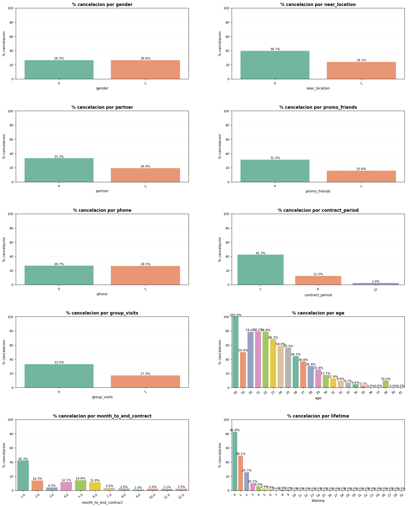
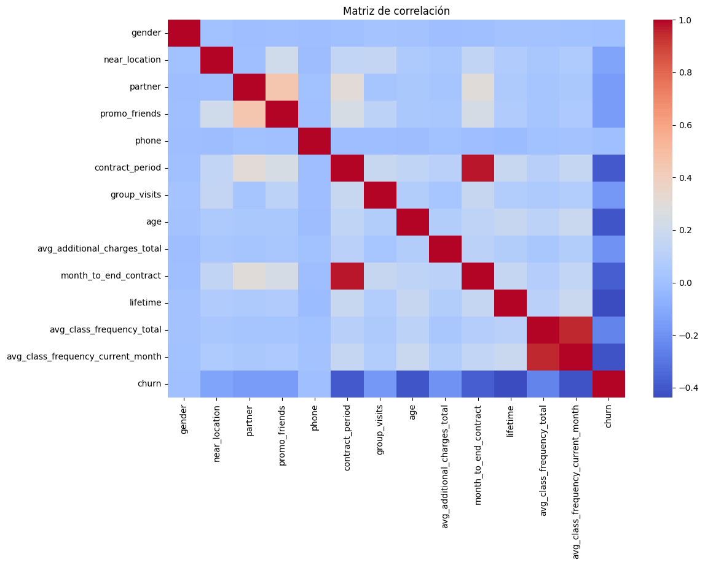
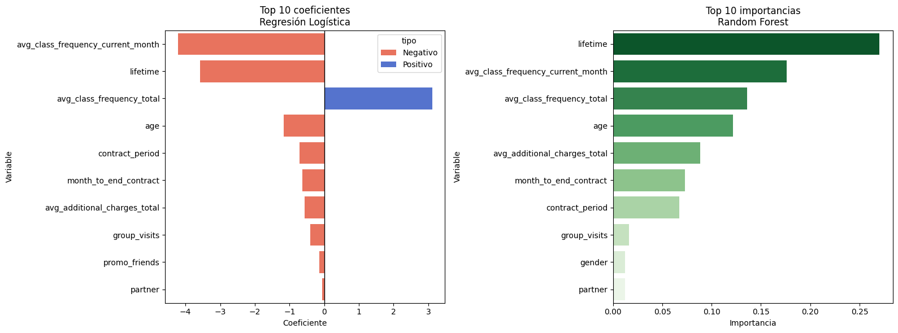
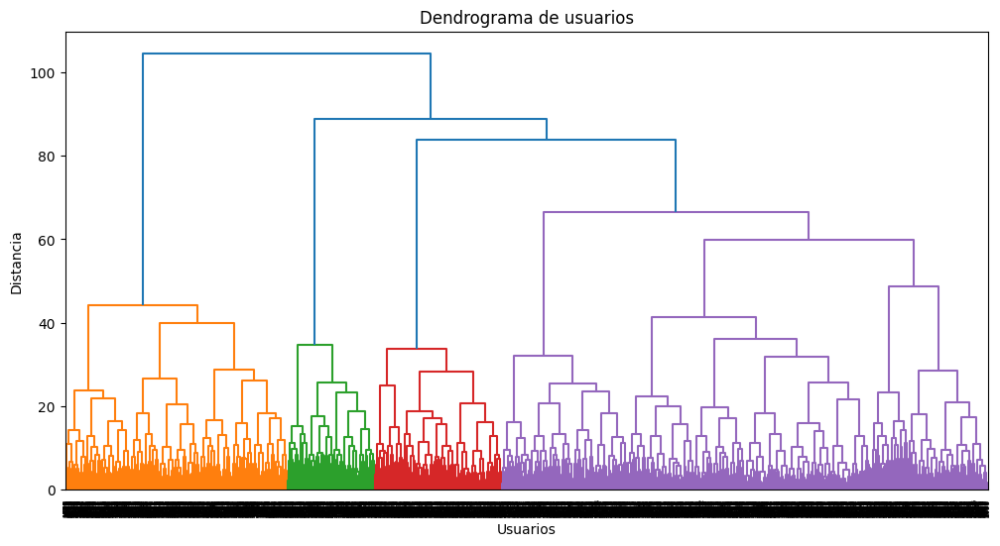
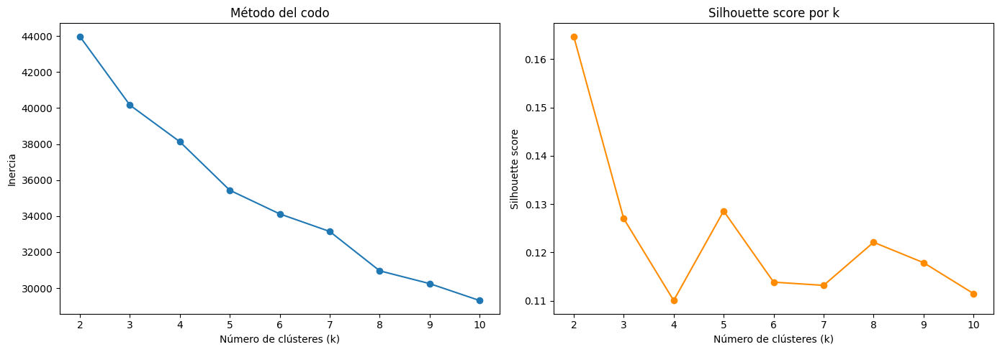
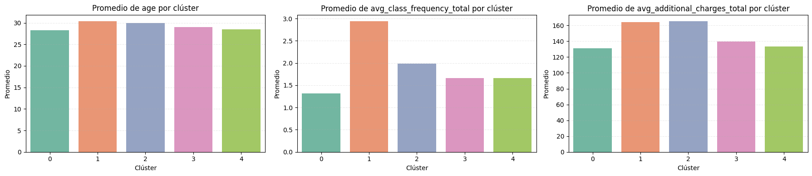
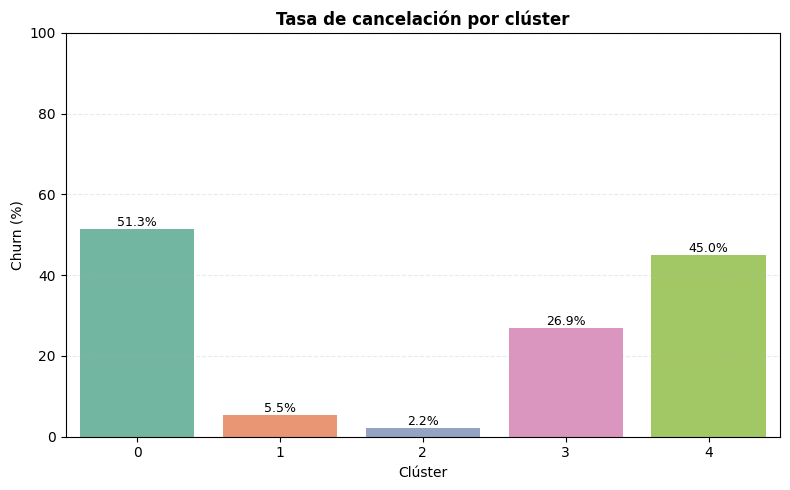

# Análisis de churn y segmentación en Model Fitness
## 📋 Contexto del proyecto
En este proyecto trabajé con los datos de una cadena de gimnasios llamada **Model Fitness**, cuyo objetivo es reducir la tasa de cancelación de membresías mediante el análisis del comportamiento de sus clientes.

El análisis busca identificar factores asociados al abandono, construir modelos predictivos capaces de anticipar la cancelación de una membresía y segmentar a los clientes en grupos con características similares para explorar estrategias de retención más efectivas.

Para ello se emplearon técnicas de **Machine Learning Supervisado** (Regresión Logística y Random Forest) para la predicción del churn y **Machine Learning No Supervisado** (K-Means) para la segmentación de clientes.

---
# 🎯 Objetivos del análisis
## Predicción de abandono
- Construir modelos capaces de predecir si un cliente cancelará su membresía.
- Comparar el desempeño de Regresión Logística y Random Forest.
- Identificar las variables relevantes para las predicciones.

## Segmentación de clientes
- Agrupar clientes con características similares.
- Comparar soluciones de tres y cinco clústeres.
- Identificar perfiles con diferentes tasas de cancelación.
- Generar recomendaciones de retención adaptadas a los segmentos identificados.

---
# 🔧 Preparación de los datos
## Objetivo
Garantizar que la información utilizada para el análisis fuera consistente y adecuada para la exploración y el entrenamiento de los modelos.

### Actividades realizadas
- Verificación de valores nulos.
- Verificación de registros duplicados.
- Revisión de tipos de datos.
- Estandarización de los nombres de las columnas.
- Estandarización de variables para los modelos que lo requieren.

### Conclusión
El conjunto de datos contiene 4,000 registros y 14 columnas. No se encontraron valores nulos ni filas duplicadas completas. Se conservaron los valores numéricos originales para los análisis, utilizando el redondeo únicamente para facilitar la visualización.

---
# 📊 Análisis Exploratorio de Datos (EDA)
## 1. Distribución de variables por grupo de churn
### Objetivo
Comparar las características de los clientes que permanecieron con las de los clientes que cancelaron su membresía.

### Gráfica

---
### Conclusión
Los clientes que cancelaron presentan diferencias en variables relacionadas con la antigüedad, la frecuencia de visitas, la duración del contrato y la participación en actividades grupales. Estas diferencias permiten identificar patrones asociados con la cancelación y explorar posibles señales tempranas de riesgo.

---
## 2. Matriz de correlaciones
### Objetivo
Analizar las relaciones entre las variables e identificar asociaciones relevantes para comprender los patrones de cancelación.

### Gráfica

---
### Conclusión
La matriz muestra asociaciones entre la duración del contrato y los meses restantes, así como entre la frecuencia de asistencia histórica y la del mes actual. También se observan asociaciones entre la cancelación y variables relacionadas con la permanencia y la frecuencia de visitas.

Estas relaciones ayudan a interpretar los datos, aunque no demuestran causalidad. La correlación entre algunas variables también debe considerarse al interpretar los modelos predictivos.

---
# 🤖 Modelado Predictivo
## 3. Comparación de modelos
### Objetivo
Comparar el desempeño de Regresión Logística y Random Forest para seleccionar el modelo más adecuado para identificar clientes que cancelan su membresía.

### Resultados
La Regresión Logística obtuvo los siguientes resultados:

- **Accuracy:** 93.50 %.
- **Precision:** 89.60 %.
- **Recall:** 85.38 %.

Random Forest obtuvo:

- **Accuracy:** 92.25 %.
- **Precision:** 87.50 %.
- **Recall:** 82.55 %.

---
### Conclusión
La Regresión Logística superó a Random Forest en las tres métricas evaluadas, por lo que se selecciona como modelo principal entre las dos alternativas comparadas.

Su recall de 85.38 % indica que identificó aproximadamente el 85 % de los clientes que realmente cancelaron dentro del conjunto de prueba. Este resultado es relevante para el objetivo de retención, aunque se recomienda realizar validaciones adicionales para comprobar la estabilidad del modelo.

---
## 4. Interpretabilidad de la Regresión Logística
### Objetivo
Analizar los coeficientes del modelo para comprender la dirección de la asociación entre las variables y la cancelación de membresías.

### Gráfica

---
### Conclusión
Los coeficientes permiten examinar cómo se relacionan las variables con las **log-odds** de cancelación, manteniendo constantes las demás características del modelo.

La interpretación debe considerar que algunas variables relacionadas con la asistencia y la permanencia están correlacionadas. Por ello, los coeficientes permiten comprender las predicciones, pero no demuestran que una variable provoque por sí sola la cancelación.

---
## 5. Importancia de variables (Random Forest)
### Objetivo
Identificar las variables relevantes para las predicciones de Random Forest y complementar la interpretación de la Regresión Logística.

### Gráfica

---
### Conclusión
Las importancias de Random Forest permiten reconocer las variables que contribuyen a las predicciones del modelo. Al compararlas con los coeficientes de la Regresión Logística, se obtiene una perspectiva complementaria sobre las características relevantes para el análisis.

Estas importancias no indican por sí solas si una variable aumenta o disminuye la cancelación, por lo que deben interpretarse junto con los resultados exploratorios y considerando la relación entre las variables.

---
# 👥 Segmentación de Clientes
## 6. Dendrograma
### Objetivo
Explorar la estructura de los datos mediante agrupamiento jerárquico y obtener una referencia para estudiar distintas alternativas de segmentación.

### Gráfica

---
### Conclusión
El dendrograma sirve como herramienta exploratoria para estudiar posibles agrupamientos. Debido al número de observaciones y a la dificultad para distinguir todas las ramas, no se considera una prueba definitiva de que exista una única solución óptima.

Por ello, se complementa con el método del codo, el coeficiente **silhouette** y el análisis de las características de los grupos.

---
## 7. Método del codo y coeficiente Silhouette
### Objetivo
Evaluar diferentes cantidades de clústeres para comparar la calidad del agrupamiento y su utilidad para el análisis de clientes.

### Gráfica

---
### Conclusión
El método del codo y el coeficiente **silhouette** permitieron evaluar distintas alternativas de agrupamiento, aunque no señalaron de forma contundente una única solución óptima. El mayor coeficiente **silhouette** observado fue de 0.1647 para dos clústeres, lo que indica una separación limitada entre los grupos.

Por ello, se continuó el análisis con tres y cinco clústeres para comparar sus características, tasas de cancelación y utilidad potencial para el negocio. La elección de cinco grupos permite explorar perfiles más específicos, aunque no implica que sea la solución matemáticamente óptima.

---
## 8. Caracterización de los clústeres
### Objetivo
Describir el comportamiento de los clientes de cada grupo obtenido mediante K-Means.

### Gráfica

---
### Conclusión
Los perfiles promedio permiten comparar características como la frecuencia de visitas, la antigüedad, la duración del contrato, la ubicación y la participación en promociones y servicios adicionales.

La segmentación complementa el modelo predictivo al permitir describir grupos de clientes con características diferentes. Esta información puede utilizarse para explorar estrategias de retención adaptadas a cada perfil, considerando también el tamaño de los segmentos y sin asumir que las diferencias observadas sean causales.

---
## 9. Tasa de churn por clúster
### Objetivo
Comparar las tasas históricas de cancelación de los segmentos para identificar cuáles podrían requerir mayor atención.

### Gráfica

---
### Conclusión
La solución de cinco clústeres presenta tasas de cancelación de aproximadamente 51.32 %, 45.04 %, 26.94 %, 5.50 % y 2.23 %. La solución de tres clústeres presenta tasas de aproximadamente 55.88 %, 8.61 % y 3.02 %.

Ambas alternativas permiten distinguir grupos con diferentes tasas de cancelación. La solución de cinco clústeres ofrece una segmentación más detallada, con dos grupos de tasas elevadas, uno intermedio y dos de tasas bajas.

Estos resultados respaldan el uso de cinco grupos para explorar perfiles y posibles acciones de retención más específicas. Las tasas representan cancelaciones observadas dentro de cada segmento, no probabilidades individuales de cancelación ni evidencia de que una estrategia de retención haya sido efectiva.

---
# 📈 Resultados
## Principales hallazgos
- La Regresión Logística obtuvo un accuracy de 93.50 %, una precision de 89.60 % y un recall de 85.38 %.
- Random Forest obtuvo un accuracy de 92.25 %, una precision de 87.50 % y un recall de 82.55 %.
- La Regresión Logística presentó el mejor desempeño en las tres métricas evaluadas.
- Se compararon soluciones de tres y cinco clústeres para estudiar distintas formas de segmentación.
- La solución de cinco clústeres permitió distinguir segmentos con diferentes tasas históricas de cancelación.
- La frecuencia de asistencia, la permanencia y las características contractuales son variables relevantes para investigar los patrones de cancelación.

---
# 📌 Conclusión
El análisis permitió identificar patrones asociados con la cancelación de membresías y desarrollar modelos capaces de reconocer a una proporción importante de los clientes que realmente abandonaron el gimnasio en el conjunto de prueba.

La Regresión Logística obtuvo los mejores resultados entre los dos modelos evaluados, mientras que la segmentación permitió complementar la predicción mediante la identificación de grupos con diferentes perfiles y tasas históricas de cancelación.

En conjunto, los resultados proporcionan una base analítica para priorizar clientes que podrían requerir atención preventiva y explorar estrategias de retención adaptadas a sus características. Sin embargo, será necesario probar las intervenciones en la práctica para determinar si reducen las cancelaciones y generan un beneficio económico para el gimnasio.

---
# 💡 Recomendaciones
- Fortalecer el proceso de incorporación de nuevos clientes durante las primeras semanas.
- Monitorear la frecuencia de asistencia para investigar posibles señales tempranas de abandono.
- Evaluar incentivos para la contratación de planes de mayor duración.
- Promover el uso de actividades grupales y servicios adicionales.
- Explorar estrategias de retención diferenciadas para los segmentos con tasas históricas de cancelación elevadas.
- Medir los resultados de las intervenciones mediante el seguimiento de las tasas de cancelación y, cuando sea posible, pruebas controladas.

---
# 📁 Código y documentación
- 📓 Notebook completo con el análisis exploratorio, el modelado predictivo y la segmentación.
- 📂 Código auxiliar del proyecto.
- 📊 Gráficas y resultados guardados en `results/images/`.
- 📄 Documentación del proyecto.
- 📦 Dependencias especificadas en `requirements.txt`. 